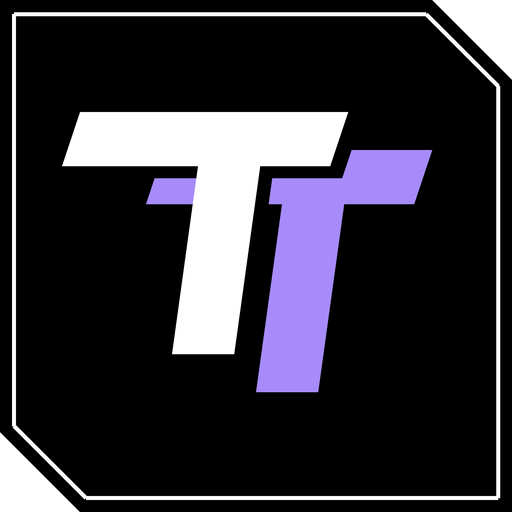

  

<h1 align="center">TeamTonex AIO</h1>

  A free all-in-one program for FiveM servers: clothing, bags, vests, the Vinewood sign, cars with emergency lights, and mods turned into FiveM resources.

  <a href="https://github.com/TeamTonex/TeamTonex-AIO/releases/latest"><b>Download the latest version</b></a>

---

## What it does

| Tab | What you make |
|---|---|
| **Bags** | Backpacks and bags, from the game's own, from a pack, from scratch or from a photo |
| **Clothing** | Tops, pants, masks, shoes and accessories, painted in layers and reshaped |
| **Vests** | Vests with pouches |
| **Sign** | Your own letters and logo on the Vinewood hill, day and night |
| **Vehicles** | Parts, rims, badges, paint and liveries, body shape, handling, and emergency lights |
| **Mods** | Any mod from gta5-mods.com or your disk turned into a FiveM resource |

Every tab exports a ready FiveM resource. Drop it into your server's `resources` folder and add `ensure name` to `server.cfg`.

### Emergency lights

- Draw a line on the car and pick one of the light sets made to fit it, with a live preview.
- LED strips bend with the body. Choose the pattern (split, sweep, centre out and more) and how many flashes each side gets.
- Ready-made sets: patrol, interceptor, unmarked, detective, fire, tow.
- Cars without siren bones get them added.

### Mods to FiveM

- Paste a gta5-mods.com link, click Download on the page that opens, and the mod is converted as soon as it arrives.
- Cars, weapons, clothing, peds, maps, sounds and textures. Every RPF archive inside is unpacked and sorted into a working resource.
- Cars get a name in game and ready lines for QBCore, Qbox and ESX.
- Big textures are made smaller so players load less.

## Install

1. Download `TeamTonex-AIO-win64.zip` from [Releases](https://github.com/TeamTonex/TeamTonex-AIO/releases/latest).
2. Unzip it anywhere you can write to (not `Program Files`).
3. Run `TeamTonex AIO.exe`.

You need Windows 10 or 11 and your own copy of GTA V. The game is only read; nothing in it changes.

## Updates

The program checks for a new version every 30 minutes, and you can check yourself in **Settings > Check for updates**. When one is out, an **Update** button shows in the title bar: it installs the new version and restarts. Your designs and settings are kept.

If this project is taken down, the program stops working. Being offline never stops it.

The only things the program connects to are GitHub, for updates, and the mod pages you open yourself. Nothing about you or your designs is sent anywhere.

## Good to know

- Mods and clothing packs belong to their authors. Check what each author allows before you share or sell the result.
- Clothing from this program has no collision, armour or damage data, so it can't be used to cheat.
- Single-player scripts (`.asi`, `.dll`) can't run on FiveM and are left out of converted mods.

## Help

- **Found a bug?** In the program, **Settings > Help > Report a bug** opens the form with your version filled in. Or [open an issue](https://github.com/TeamTonex/TeamTonex-AIO/issues/new/choose) here.
- **Have an idea?** **Settings > Help > Suggest an idea**, or the same link.
- **Question?** Ask in [Discussions](https://github.com/TeamTonex/TeamTonex-AIO/discussions).

## Licence

TeamTonex AIO is free to use, but it isn't open source: see [LICENSE](LICENSE). It is not affiliated with Rockstar Games, Take-Two Interactive or Cfx.re.
