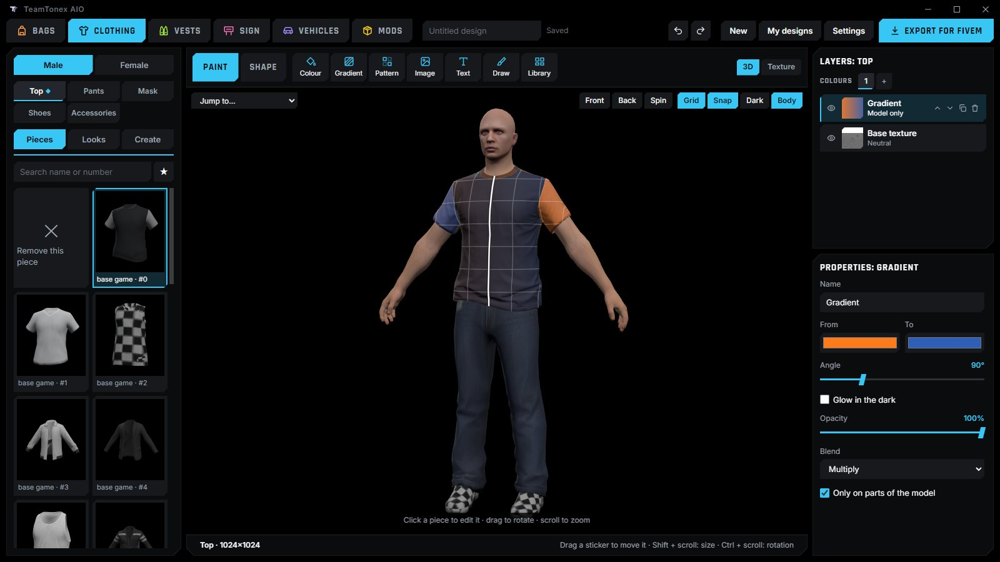
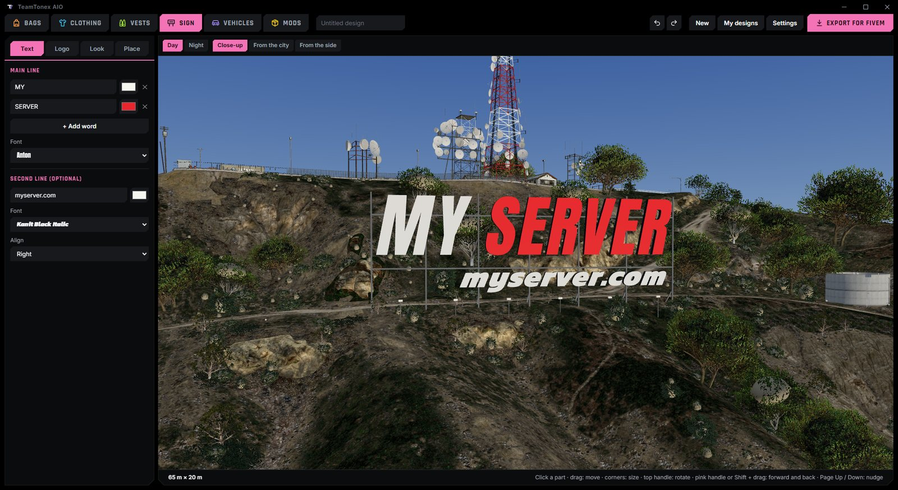
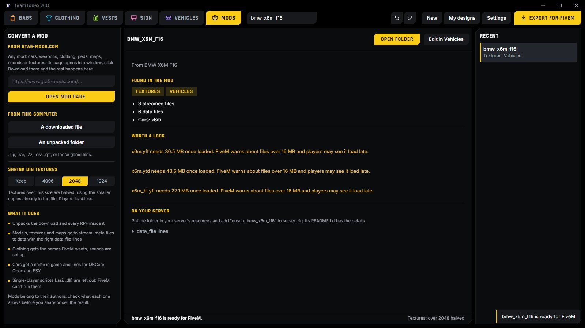

  

<h1 align="center">TeamTonex AIO: free FiveM clothing creator, vehicle editor and mod converter</h1>

  One free Windows program for FiveM servers. Make custom clothing, EUP-style uniforms, backpacks and vests, put your own letters on the Vinewood sign, edit cars and add emergency lights, and turn gta5-mods.com downloads into FiveM resources.

  <a href="https://github.com/TeamTonex/TeamTonex-AIO/releases/latest"><b>Download the latest version</b></a>
  &nbsp;·&nbsp;
  <a href="https://teamtonex.github.io/TeamTonex-AIO/">Website</a>
  &nbsp;·&nbsp;
  <a href="https://github.com/TeamTonex/TeamTonex-AIO/discussions">Questions</a>

  

---

## What it does

| Tab | What you make |
|---|---|
| **Bags** | Custom backpacks and bags for FiveM, from the game's own, from a clothing pack, from scratch or from a photo |
| **Clothing** | Tops, pants, masks, shoes and accessories, painted in layers and reshaped: uniforms, gang colours, server merch |
| **Vests** | Vests with pouches, for police and EUP-style outfits |
| **Sign** | Your own letters and logo on the real Vinewood hill, day and night |
| **Vehicles** | A FiveM vehicle editor: parts, rims, badges, paint and liveries, body shape, handling, sirens and LED lightbars |
| **Mods** | Any gta5-mods.com mod, RPF or .oiv turned into a FiveM resource |

Every tab exports a ready FiveM resource. Drop it into your server's `resources` folder and add `ensure name` to `server.cfg`. It works with QBCore, Qbox, ESX and standalone servers.

### FiveM clothing creator

- Pick any piece from your own copy of GTA V for the male or female freemode body, or import a clothing pack you downloaded.
- Paint in layers: colour, gradient, pattern, images, text and drawing, then see it on the body in 3D.
- Reshape pieces, cut sleeves, or make bags and vests from scratch.
- Export a streamed clothing resource with the names FiveM expects, ready for your clothing menu.

### Vinewood sign

  

- Your server's name, a second line and a logo, shown on the real hill read from your own game.
- Move, size and tilt every part, check it at night and from the city, then export it as a map resource.

### Vehicles and emergency lights

- Draw a line on the car and pick one of the light sets made to fit it, with a live preview.
- LED strips and lightbars bend with the body. Choose the pattern (split, sweep, centre out and more) and how many flashes each side gets.
- Ready-made sets: patrol, interceptor, unmarked, detective, fire, tow.
- Cars without siren bones get them added, so any car can carry sirens.

### gta5-mods to FiveM converter

  

- Paste a gta5-mods.com link, click Download on the page that opens, and the mod is converted as soon as it arrives. A file you downloaded earlier works too: .zip, .rar, .7z, .oiv or .rpf.
- Cars, weapons, clothing, peds, maps, sounds and textures. Every RPF archive inside is unpacked and sorted into `stream` and `data` with the right `data_file` lines.
- Cars get a name in game and ready lines for QBCore, Qbox and ESX. When a car comes as Add-On and Replace, only the Add-On is used.
- Big textures are made smaller so players load less.

## Install

1. Download `TeamTonex-AIO-win64.zip` from [Releases](https://github.com/TeamTonex/TeamTonex-AIO/releases/latest).
2. Unzip it anywhere you can write to (not `Program Files`).
3. Run `TeamTonex AIO.exe`.

You need Windows 10 or 11 and your own copy of GTA V. The game is only read; nothing in it changes.

## Updates

The program keeps itself up to date from GitHub: it checks for a new version when it starts and every 30 minutes, and you can check yourself in **Settings > Check for updates**. Updates install by themselves and the program restarts. Your designs and settings are kept.

If this project is taken down, the program stops working. Being offline never stops it.

The only things the program connects to are GitHub, for updates, and the mod pages you open yourself. Nothing about you or your designs is sent anywhere.

## FAQ

**How do I make custom clothing for FiveM?**
Open the Clothing tab, pick a piece, paint it or add your own image, and press Export for FiveM. You get a resource with the clothing already named the way FiveM streams it. Put it in `resources`, add `ensure` to `server.cfg`, and it shows up in your clothing menu.

**How do I convert a gta5-mods car to FiveM?**
In the Mods tab, paste the car's gta5-mods.com link and click Download on the page that opens, or pick the file you already downloaded. The program unpacks the archive and its `dlc.rpf`, and writes the `fxmanifest.lua`, `stream` folder, meta files and the car's name for you.

**How do I add sirens or an LED lightbar to a FiveM car?**
Open the car in the Vehicles tab, go to Lights, and either draw a line where the lights should go or pick a ready-made set. The program adds siren bones if the car has none and writes the `carcols.meta` siren setting.

**Is it really free?**
Yes. There is no account, no watermark and nothing to pay.

**Does it work without GTA V?**
No. Models and textures come from your own copy of GTA V, which the program only reads.

## Good to know

- Mods and clothing packs belong to their authors. Check what each author allows before you share or sell the result.
- Clothing from this program has no collision, armour or damage data, so it can't be used to cheat.
- Single-player scripts (`.asi`, `.dll`) can't run on FiveM and are left out of converted mods.

## Help

- **Found a bug?** In the program, **Settings > Help > Report a bug** opens the form with your version filled in. Or [open an issue](https://github.com/TeamTonex/TeamTonex-AIO/issues/new/choose) here.
- **Have an idea?** **Settings > Help > Suggest an idea**, or the same link.
- **Question?** Ask in [Discussions](https://github.com/TeamTonex/TeamTonex-AIO/discussions).

## Licence

TeamTonex AIO is free to use, but it isn't open source: see [LICENSE](LICENSE). It is not affiliated with Rockstar Games, Take-Two Interactive or Cfx.re.
